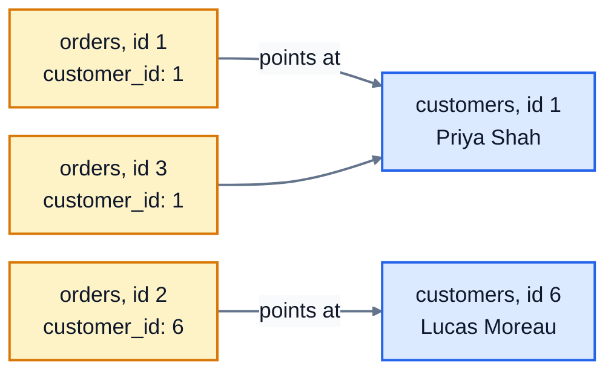

# 1. What is a database?

A **database** is an organised store of data that a program can search and change quickly and safely, even when lots of people use it at once. When you check your bank balance, add something to a basket or post a message, a database is doing the work behind the scenes.

## Why not just use a spreadsheet?

For a list of 50 books, a spreadsheet is fine. Now imagine the bookshop has 200,000 customers, a million orders, and a website where hundreds of people order at the same moment. A database handles what a spreadsheet can't:

- **Size and speed.** Finding one order among a million takes milliseconds.
- **Many users at once.** Two customers buying the last copy of a book at the same moment can't both get it.
- **Rules.** The database can refuse bad data, like an order for a customer who doesn't exist, or a negative price.
- **Safety.** If the power fails in the middle of saving an order, you get all of the order or none of it, never half.

## Tables, rows and columns

The most common kind of database is a **relational database**. It stores data in **tables**, which look a lot like spreadsheet sheets. Here are the first few rows of the bookshop's `customers` table:

| id | name | email | city | joined_on |
|---|---|---|---|---|
| 1 | Priya Shah | priya.shah@example.com | Leeds | 2024-02-11 |
| 2 | Tom Becker | tom.becker@example.com | Manchester | 2024-03-02 |
| 3 | Aisha Bello | aisha.bello@example.com | London | 2024-03-19 |
| 4 | Daniel Okafor | daniel.okafor@example.com | Leeds | 2024-05-07 |

- Each **row** is one thing: here, one customer. (Rows are also called records.)
- Each **column** is one fact about it, like the email. Every row has the same columns.
- Each column has a **type**: `id` is a whole number (`INTEGER`), `name` is text (`TEXT`). In SQLite, dates are stored as text in the form `YYYY-MM-DD`, which sorts correctly.

Unlike a spreadsheet, the rows have no fixed order. If you want them sorted, you ask for that when you query (lesson 2).

## Keys: how tables point at each other

Every table has a **primary key**: a column whose value is different for every row, so it identifies exactly one row. Here it's `id`. Two customers might share a name, but never an id.

Now look at the start of the `orders` table:

| id | customer_id | ordered_on | status |
|---|---|---|---|
| 1 | 1 | 2025-04-06 | delivered |
| 2 | 6 | 2025-04-10 | delivered |
| 3 | 1 | 2025-04-11 | delivered |

`customer_id` is a **foreign key**: it holds the `id` of a row in another table. Order 2 has `customer_id` 6, which means "this order was placed by customer 6", Lucas Moreau.



Why not just write "Priya Shah, priya.shah@example.com, Leeds" on every order? Because Priya has placed six orders. If she moves to York, you'd have to change six rows, and if you missed one, the database would disagree with itself. Storing her details **once**, and pointing at them by id, avoids that. This is the "relational" part of relational database, and lesson 9 goes into it properly.

The diagram at the top of the [course README](../README.md) shows all four tables and how they link: a customer places orders, an order contains order items, and each order item is one book.

## NULL: no value

Hannah Fischer didn't give her city, so her `city` is **NULL**. NULL means "no value" or "unknown". It isn't zero, and it isn't empty text. It behaves in special ways that lesson 3 covers.

## SQL

You talk to a relational database in **SQL** (Structured Query Language; people say "S-Q-L" or "sequel"). An SQL command is called a **statement**, and a statement that asks for data is a **query**. Your first one:

```sql
SELECT * FROM customers;
```

- `SELECT` means "give me some data".
- `*` means "every column".
- `FROM customers` says which table.
- The `;` ends the statement.

To get only some columns, list them, separated by commas:

```sql
SELECT title, author FROM books;
```

```
title                author
-------------------  --------------
The Hobbit           J.R.R. Tolkien
Dune                 Frank Herbert
Pride and Prejudice  Jane Austen
...
```

A few things that trip people up:

- SQL keywords aren't case-sensitive: `select` works as well as `SELECT`. Writing keywords in capitals is a common habit that makes queries easier to read.
- Text goes in **single** quotes: `'Leeds'`. (Double quotes are for names of tables and columns, and you'll rarely need them.)
- Spaces and new lines don't matter, so you can split a long query over several lines.
- `--` starts a comment, which the database ignores.

## Which database?

There are many relational databases: PostgreSQL, MySQL, Microsoft SQL Server, Oracle and **SQLite**. They all speak SQL, with small differences. This course uses SQLite, because it comes built into Python, it keeps a whole database in a single file, and it's everywhere: every phone and every web browser has SQLite inside. Almost everything you learn here works the same way in the others.

### The sqlite3 shell (optional)

If you've installed the `sqlite3` program, you can explore the database by hand. First save a copy of it to a file:

```bash
python3 run.py --save bookshop.db
sqlite3 bookshop.db
```

Commands starting with a dot are shell commands, not SQL. `.tables` lists the tables, and `.schema` shows how a table was created:

```
sqlite> .tables
books        customers    order_items  orders
sqlite> .schema books
CREATE TABLE books (
  id        INTEGER PRIMARY KEY,
  title     TEXT NOT NULL,
  author    TEXT NOT NULL,
  genre     TEXT NOT NULL,
  price     REAL NOT NULL CHECK (price > 0),
  stock     INTEGER NOT NULL DEFAULT 0 CHECK (stock >= 0),
  published INTEGER
);
sqlite> SELECT * FROM books LIMIT 3;
1|The Hobbit|J.R.R. Tolkien|Fantasy|9.99|14|1937
2|Dune|Frank Herbert|Science Fiction|10.99|8|1965
3|Pride and Prejudice|Jane Austen|Classics|6.99|20|1813
```

Type `.mode box` for neater tables, and `.quit` to leave. You don't need the shell for this course: `run.py` does the same job.

## Exercise: your first queries

Open [exercise.sql](./exercise.sql) and write three queries:

1. Every column of every customer.
2. The title and author of every book.
3. The id, customer_id and status of every order.

See what they return, from the lesson's folder:

```bash
cd 01-what-is-a-database
python3 ../run.py exercise.sql
```

Then check them:

```bash
python3 -m unittest -v
```

<details>
<summary>Hint</summary>

Each answer is one line: `SELECT`, then the columns (or `*`), then `FROM` and the table name, then `;`. The table names are `customers`, `books` and `orders`.

</details>

The answers are in [solutions/01-what-is-a-database.sql](../solutions/01-what-is-a-database.sql).

## Recap

- A relational database stores data in **tables** of **rows** and **columns**.
- A **primary key** identifies each row. A **foreign key** points at a row in another table.
- **NULL** means no value.
- `SELECT columns FROM table;` reads data. `*` means every column.

Next: [2. Selecting data](../02-selecting-data/)
