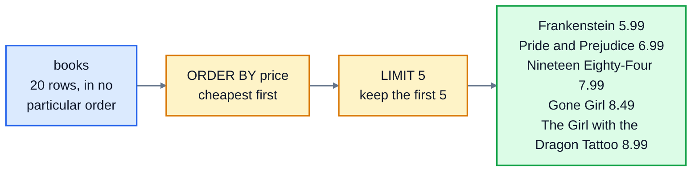

# 2. Selecting data

In lesson 1 you asked for whole columns. This lesson shapes the answer: calculating new columns, sorting the rows, taking just the top few, and removing repeats. By the end you can answer questions like "what are our five cheapest books?" and "how much is our stock worth?".

## How a SELECT is put together

A query is made of **clauses**, and they always go in this order:

```sql
SELECT   columns or calculations
FROM     a table
WHERE    which rows to keep        -- lesson 3
ORDER BY how to sort them
LIMIT    how many to show;
```

Only `SELECT` is required (try `SELECT 1 + 1;`). The others are added when you need them.

## Calculating columns

A column in a `SELECT` doesn't have to be stored in the table. It can be a calculation:

```sql
SELECT title, price, price * 1.2 FROM books LIMIT 3;
```

```
title                price  price * 1.2
-------------------  -----  -----------
The Hobbit           9.99   11.988
Dune                 10.99  13.188
Pride and Prejudice  6.99   8.388
```

The table isn't changed: the database works out `price * 1.2` for each row as it answers. You can use `+`, `-`, `*`, `/` and brackets.

### Naming a column with AS

`price * 1.2` isn't a helpful column name. Give it a better one with `AS`:

```sql
SELECT title, price * stock AS stock_value FROM books;
```

The new name is called an **alias**. It shows in the results, and you can use it later in the same query, for example in `ORDER BY`.

### Rounding

Computers store decimal numbers like 12.99 in binary, which can't represent most of them exactly. Usually you don't notice, but sometimes a tiny error shows up:

```
title         price  stock  price * stock
------------  -----  -----  ------------------
Sapiens       12.99  11     142.89000000000001
Frankenstein  5.99   10     59.900000000000006
```

`ROUND(value, 2)` rounds to 2 decimal places, which is what you want for money: `ROUND(price * stock, 2)` gives `142.89`. Note that SQLite drops trailing zeros, so `139.80` is shown as `139.8`.

One more surprise: dividing two whole numbers gives a whole number. `7 / 2` is `3`, not `3.5`. Write `7 / 2.0` to get `3.5`.

## Sorting with ORDER BY

```sql
SELECT title, published FROM books ORDER BY published LIMIT 3;
```

```
title                published
-------------------  ---------
Pride and Prejudice  1813
Frankenstein         1818
The Hobbit           1937
```

`ORDER BY` sorts **ascending** (smallest first, A to Z, oldest date first) unless you add `DESC` for **descending**:

```sql
SELECT title, price FROM books ORDER BY price DESC;
```

Without `ORDER BY`, the database returns rows in whatever order is quickest for it. That often looks like the order they were added, but nothing guarantees it. **If the order matters, say so.**

### Breaking ties

Three books cost 9.99. When you sort by price, which comes first? The database doesn't promise anything. To make the order certain, add a second column to sort by when the first is equal:

```sql
SELECT title, price
FROM books
WHERE price = 9.99
ORDER BY price DESC, title;
```

```
title                     price
------------------------  -----
Normal People             9.99
The Hobbit                9.99
The Thursday Murder Club  9.99
```

Each column in `ORDER BY` can have its own direction: `ORDER BY price DESC, title` means "most expensive first, and among equal prices, title A to Z".

## Taking the top few with LIMIT

`LIMIT 5` returns at most 5 rows. With `ORDER BY`, it answers "top N" questions:

```sql
SELECT title, price FROM books ORDER BY price LIMIT 5;   -- the 5 cheapest
```

The order matters: the rows are sorted first, and only then cut down to five.



`OFFSET` skips rows first, which is how websites show results a page at a time. `LIMIT 3 OFFSET 3` gives rows 4 to 6:

```
title                            price
-------------------------------  -----
Gone Girl                        8.49
The Girl with the Dragon Tattoo  8.99
The Martian                      9.49
```

`LIMIT` without `ORDER BY` gives you *some* rows, not the first or the best.

## Removing repeats with DISTINCT

`SELECT genre FROM books;` gives one genre per book, so Science Fiction appears three times. `DISTINCT` keeps one of each:

```sql
SELECT DISTINCT genre FROM books ORDER BY genre;
```

```
genre
---------------
Classics
Crime
Fantasy
Fiction
Non-fiction
Science Fiction
```

With several columns, `DISTINCT` removes rows where **all** the columns repeat.

### Where does NULL go?

When you sort a column that contains NULL, SQLite puts the NULLs **first** in ascending order (and last in descending order). Some other databases do the opposite. You'll see this in question 6.

## Exercise: choosing and sorting columns

Open [exercise.sql](./exercise.sql) and answer the six questions:

1. The title and price of every book, most expensive first. Break ties by title, A to Z.
2. The title and price of the 5 cheapest books, cheapest first.
3. Every genre, listed once each, A to Z.
4. Each book's title and the value of its stock (price times stock, rounded to 2 places), called `stock_value`. Biggest value first, then title A to Z.
5. The name and joined_on date of the 3 customers who joined most recently, newest first.
6. Every city customers live in, listed once each, A to Z.

```bash
cd 02-selecting-data
python3 ../run.py exercise.sql
python3 -m unittest -v
```

The tests check the order of the rows wherever the question asks for one.

<details>
<summary>Hints</summary>

- Q1: `ORDER BY price DESC, title`.
- Q4: `ROUND(price * stock, 2) AS stock_value`, then you can `ORDER BY stock_value DESC, title`.
- Q5: dates written as `YYYY-MM-DD` sort correctly as text, so `ORDER BY joined_on DESC` puts the newest first.
- Q6: one customer's city is NULL, and it counts as a value here, so the answer has 6 rows.

</details>

The answers are in [solutions/02-selecting-data.sql](../solutions/02-selecting-data.sql).

## Recap

- Clauses go in the order `SELECT`, `FROM`, `WHERE`, `ORDER BY`, `LIMIT`.
- You can calculate columns, and name them with `AS`. Use `ROUND(x, 2)` for money.
- `ORDER BY col` sorts ascending; add `DESC` for descending, and more columns to break ties.
- `LIMIT n` keeps the first n rows; it only means "top n" together with `ORDER BY`.
- `DISTINCT` removes repeated rows.

Next: [3. Filtering rows](../03-filtering-rows/)
