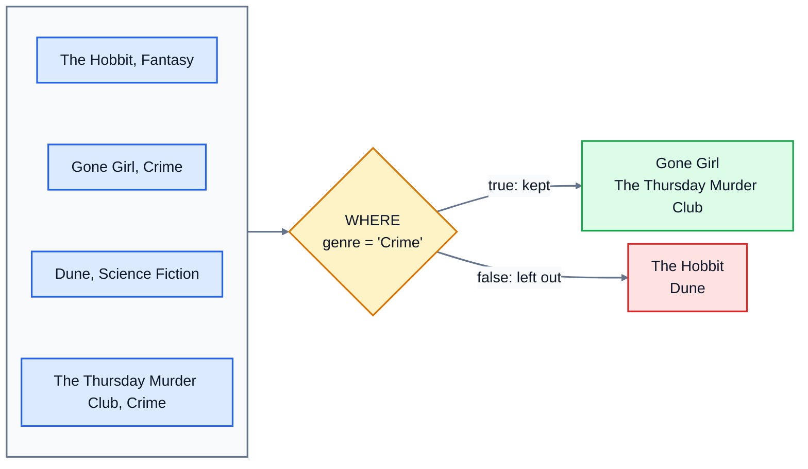

# 3. Filtering rows

Most questions aren't about every row. "Which books are out of stock?" "Which orders haven't been delivered yet?" `WHERE` keeps only the rows that match a condition.

## WHERE

```sql
SELECT title, price
FROM books
WHERE genre = 'Crime';
```

The database checks the condition for every row. Rows where it's true are kept; the rest are left out of the answer. They're not deleted, just not shown.



### Comparisons

| Operator | Means | Example |
|---|---|---|
| `=` | equal to (one `=`, not two) | `genre = 'Crime'` |
| `<>` or `!=` | not equal to | `status <> 'delivered'` |
| `<`, `>` | less than, greater than | `price < 9.50` |
| `<=`, `>=` | less or equal, greater or equal | `stock >= 5` |

Text comparisons with `=` are **case-sensitive** in SQLite: `genre = 'crime'` finds nothing, because the data says `'Crime'`. Text and dates can also use `<` and `>`: `joined_on < '2025-01-01'` finds everyone who joined before 2025.

## Combining conditions: AND, OR, NOT

- `AND`: both must be true. `genre = 'Fantasy' AND stock > 0`
- `OR`: at least one must be true. `genre = 'Fantasy' OR genre = 'Crime'`
- `NOT`: turns true into false. `NOT genre = 'Crime'`

### Watch out: AND comes before OR

Say you want the Crime and Fantasy books under 9.00. This looks right:

```sql
SELECT title, genre, price
FROM books
WHERE genre = 'Crime' OR genre = 'Fantasy' AND price < 9;
```

```
title                            genre  price
-------------------------------  -----  -----
The Girl with the Dragon Tattoo  Crime  8.99
Gone Girl                        Crime  8.49
The Thursday Murder Club         Crime  9.99
```

The Thursday Murder Club costs 9.99, so why is it there? `AND` is worked out before `OR`, just as `*` comes before `+` in maths. So the database read it as `genre = 'Crime' OR (genre = 'Fantasy' AND price < 9)`: every Crime book, plus cheap Fantasy books. Use brackets to say what you mean:

```sql
WHERE (genre = 'Crime' OR genre = 'Fantasy') AND price < 9
```

```
title                            genre  price
-------------------------------  -----  -----
The Girl with the Dragon Tattoo  Crime  8.99
Gone Girl                        Crime  8.49
```

Whenever you mix `AND` and `OR`, add brackets. It costs nothing and avoids this bug.

## Shortcuts: IN and BETWEEN

`IN` checks against a list, and is shorter than a chain of `OR`s:

```sql
WHERE genre IN ('Fantasy', 'Science Fiction')
WHERE status NOT IN ('delivered', 'cancelled')
```

`BETWEEN` checks a range, **including both ends**:

```sql
WHERE published BETWEEN 2010 AND 2019      -- the same as published >= 2010 AND published <= 2019
```

## Searching text with LIKE

`LIKE` matches a pattern, with two wildcards:

- `%` stands for any number of characters, including none.
- `_` stands for exactly one character.

| Pattern | Matches |
|---|---|
| `title LIKE 'The%'` | titles starting with "The" |
| `title LIKE '%Library'` | titles ending with "Library" |
| `title LIKE '%the%'` | titles with "the" anywhere |
| `title LIKE '_une'` | four letters ending in "une", like "Dune" |

In SQLite, `LIKE` ignores case for English letters, so `'the%'` also finds "The Hobbit". (In PostgreSQL it doesn't; there you'd use `ILIKE`.) Remember that `'%the%'` matches "the" inside other words too, like "brother" or "theory".

## NULL needs IS NULL

Hannah Fischer's city is NULL. Try finding her with `=`:

```sql
SELECT name FROM customers WHERE city = NULL;
```

```
name
----
(0 rows)
```

Nothing. NULL means "unknown", and SQL's rule is that comparing anything with an unknown value gives **unknown**, not true or false. Is an unknown city equal to NULL? Unknown. `WHERE` only keeps rows where the condition is **true**, so the row is left out. You have to ask differently:

```sql
SELECT name FROM customers WHERE city IS NULL;       -- Hannah Fischer
SELECT name FROM customers WHERE city IS NOT NULL;   -- everyone else
```

The same rule causes a sneakier surprise. Three customers live in Leeds, and there are 12 customers, so you'd expect `WHERE city <> 'Leeds'` to give 9 rows. It gives 8: is Hannah's unknown city "not Leeds"? Unknown, so she's left out. When a column can be NULL, think about what should happen to those rows, and add `OR city IS NULL` if you want them.

## Exercise: filtering rows

Open [exercise.sql](./exercise.sql) and answer the seven questions:

1. The title and price of every Crime book.
2. The title and price of every book under 9.50, cheapest first, then title A to Z.
3. The title and genre of Fantasy and Science Fiction books that are in stock. Use `IN`.
4. The title and published year of books published from 2010 to 2019, oldest first, then title A to Z. Use `BETWEEN`.
5. The title of every book with the word "the" anywhere in its title, in any case.
6. The name and email of customers whose city isn't known.
7. The id and status of every order that's still on its way: not delivered and not cancelled.

```bash
cd 03-filtering-rows
python3 ../run.py exercise.sql
python3 -m unittest -v
```

<details>
<summary>Hints</summary>

- Q2: `WHERE price < 9.5`, then `ORDER BY price, title`.
- Q3: "in stock" means `stock > 0`. Combine it with the genre check using `AND`.
- Q5: `LIKE '%the%'`. SQLite ignores case, so this finds "The" at the start too.
- Q6: `IS NULL`, not `= NULL`.
- Q7: `NOT IN ('delivered', 'cancelled')`.

</details>

The answers are in [solutions/03-filtering-rows.sql](../solutions/03-filtering-rows.sql).

## Recap

- `WHERE` keeps the rows where a condition is true.
- Combine conditions with `AND`, `OR` and `NOT`. `AND` goes first, so use brackets when you mix them.
- `IN (...)` checks a list. `BETWEEN a AND b` includes both ends.
- `LIKE` matches patterns: `%` is any characters, `_` is one character.
- NULL is never equal to anything. Use `IS NULL` and `IS NOT NULL`.

Next: [4. Creating tables](../04-creating-tables/)
