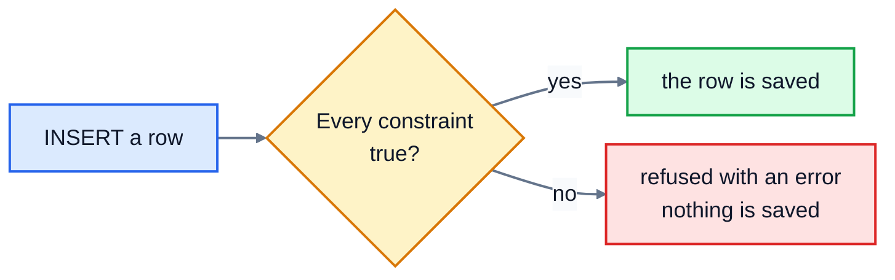

# 4. Creating tables

The bookshop wants to let customers review books. There's nowhere to store reviews yet, so in this lesson you'll create a new table for them, with rules that stop bad data getting in, and then add some rows.

## CREATE TABLE

Here's how the `books` table was made:

```sql
CREATE TABLE books (
  id        INTEGER PRIMARY KEY,
  title     TEXT NOT NULL,
  author    TEXT NOT NULL,
  genre     TEXT NOT NULL,
  price     REAL NOT NULL CHECK (price > 0),
  stock     INTEGER NOT NULL DEFAULT 0 CHECK (stock >= 0),
  published INTEGER
);
```

Each line inside the brackets defines one column: its **name**, its **type**, and any **constraints** (rules). Lines are separated by commas, with **no comma after the last one**. That missing or extra comma is the most common error you'll see.

### Types

SQLite has a small set of types:

| Type | Holds | Examples |
|---|---|---|
| `INTEGER` | whole numbers | ids, stock counts, years |
| `REAL` | decimal numbers | prices, weights |
| `TEXT` | text | names, emails, dates like `'2025-07-12'` |
| `BLOB` | raw bytes, stored exactly as given | images, files |

SQLite has no separate date type: dates are stored as `TEXT` in the form `YYYY-MM-DD`, which sorts correctly, and SQLite's date functions understand it. Other databases have more types (`DATE`, `VARCHAR(100)`, `DECIMAL(10, 2)` and so on), but the idea is the same.

SQLite is also unusually relaxed about types. By default, it will let you store `'hello'` in an `INTEGER` column. Other databases refuse. You can ask SQLite to be strict by adding `STRICT` after the closing bracket of `CREATE TABLE`, but it's better to rely on good constraints and careful code.

### Constraints

Constraints are rules the database enforces on every row, every time, whatever program is writing to it. They're your last line of defence against bad data.

| Constraint | Means | If it's broken |
|---|---|---|
| `PRIMARY KEY` | identifies each row; must be unique | |
| `NOT NULL` | a value is required | `NOT NULL constraint failed: books.author` |
| `UNIQUE` | no two rows can have the same value | `UNIQUE constraint failed: customers.email` |
| `CHECK (...)` | the condition must be true | `CHECK constraint failed: price > 0` |
| `DEFAULT value` | used when an INSERT doesn't give a value | |
| `REFERENCES other(id)` | a foreign key: must match a row in the other table | `FOREIGN KEY constraint failed` |

Those error messages are real: they're what SQLite says when you break each rule. Here's what happens to every row you insert:



A `CHECK` can be any condition that would work in a `WHERE`: `CHECK (stock >= 0)`, `CHECK (status IN ('pending', 'shipped', 'delivered', 'cancelled'))`, `CHECK (rating BETWEEN 1 AND 5)`.

> **SQLite only checks foreign keys if you ask it to**, with `PRAGMA foreign_keys = ON;` each time you connect. It's off by default for historical reasons. This course's `run.py` and tests turn it on for you. Other databases always check.

## INSERT

`INSERT` adds rows. List the columns, then the values in the same order:

```sql
INSERT INTO books (title, author, genre, price)
VALUES ('Example', 'A. Writer', 'Fiction', 7.50);
```

Columns you leave out get their `DEFAULT` (`stock` becomes 0) or NULL (`published`). And `id`? An `INTEGER PRIMARY KEY` that you leave out is filled in automatically with the next number, so this book gets id 21. **Let the database choose ids**; working them out yourself goes wrong as soon as two people add rows at once.

You can add several rows in one statement:

```sql
INSERT INTO customers (name, email, city, joined_on) VALUES
  ('Ella Brooks', 'ella.brooks@example.com', 'York', '2025-07-12'),
  ('Sam Ortiz',   'sam.ortiz@example.com',   NULL,   '2025-07-13');
```

Text goes in single quotes. To put a single quote inside text, double it: `'Siobhán O''Neill'`. Numbers and `NULL` have no quotes.

It's possible to write `INSERT INTO books VALUES (...)` with no column list, giving a value for every column in order, but don't: if someone adds a column to the table later, your statement breaks.

## Changing your mind: DROP TABLE

`DROP TABLE reviews;` deletes a table and everything in it, with no undo. With `run.py` it doesn't matter, because every run starts from a fresh database. On a real database, be very careful.

## Exercise: add reviews to the bookshop

Open [exercise.sql](./exercise.sql). The answers run in order, so later questions can use the table you create in Q1.

**Q1.** Create a table called `reviews` with these columns, in this order:

| Column | Type | Rules |
|---|---|---|
| `id` | `INTEGER` | the primary key |
| `book_id` | `INTEGER` | required; must be the id of a book |
| `customer_id` | `INTEGER` | required; must be the id of a customer |
| `rating` | `INTEGER` | required; a whole number from 1 to 5 |
| `comment` | `TEXT` | optional |
| `reviewed_on` | `TEXT` | required (the date) |

**Q2.** Add these three reviews. Let the database choose each id.

| book_id | customer_id | rating | comment | reviewed_on |
|---|---|---|---|---|
| 5 | 1 | 5 | Changed how I think about history. | 2025-04-20 |
| 19 | 3 | 4 | A lovely, gentle read. | 2025-06-02 |
| 8 | 6 | 3 | *(no comment)* | 2025-06-14 |

**Q3.** The shop has a new book: *Tomorrow, and Tomorrow, and Tomorrow* by Gabrielle Zevin, genre Fiction, price 10.99, 6 in stock, published 2022. Add it, and let the database choose its id.

**Q4.** A new customer has signed up: Ella Brooks, email ella.brooks@example.com, from York, joined on 2025-07-12. Add her.

```bash
cd 04-creating-tables
python3 ../run.py exercise.sql
python3 -m unittest -v
```

The tests for Q1 try to insert bad reviews (a rating of 6, a missing date, a book that doesn't exist and so on) and check that your table refuses every one of them.

<details>
<summary>Hints</summary>

- Q1: `book_id INTEGER NOT NULL REFERENCES books(id)`, and `rating INTEGER NOT NULL CHECK (rating BETWEEN 1 AND 5)`. A column with no rules is just its name and type: `comment TEXT`.
- Q2: one `INSERT` with three sets of brackets after `VALUES`, separated by commas. Leave `id` out of the column list. For "no comment", write `NULL`.
- Q3: the title has commas in it, which is fine inside quotes: `'Tomorrow, and Tomorrow, and Tomorrow'`.

</details>

The answers are in [solutions/04-creating-tables.sql](../solutions/04-creating-tables.sql).

## Recap

- `CREATE TABLE name (column TYPE rules, ...)` makes a table. No comma after the last column.
- Constraints (`NOT NULL`, `UNIQUE`, `CHECK`, `REFERENCES`) make the database refuse bad data.
- In SQLite, turn on foreign key checks with `PRAGMA foreign_keys = ON;`.
- `INSERT INTO table (columns) VALUES (...), (...);` adds rows. Leave the id out and let the database number it.

Next: [5. Changing data](../05-changing-data/)
