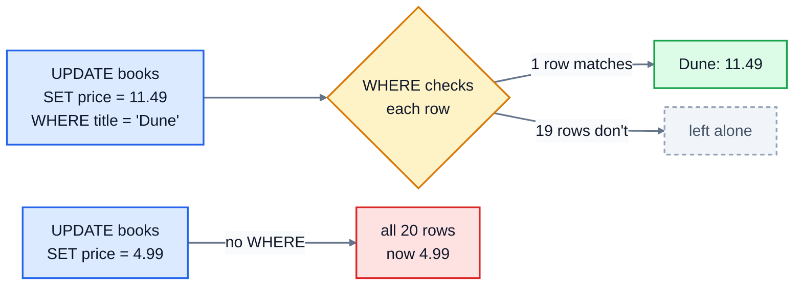

# 5. Changing data

Data changes all the time. Prices go up, orders get posted, stock arrives, customers leave. This lesson covers the three statements that change what's stored: `UPDATE`, `DELETE` and `ALTER TABLE`. They're short and simple, and they're also the statements most likely to cause a disaster, so you'll learn the safe habit first.

## UPDATE

`UPDATE` changes values in rows that already exist:

```sql
UPDATE books
SET price = 11.49
WHERE title = 'Dune';
```

- `UPDATE books` says which table.
- `SET price = 11.49` says what to change. Change several columns at once with commas: `SET status = 'shipped', ordered_on = '2025-06-30'`.
- `WHERE ...` says **which rows**. It works exactly like the `WHERE` in a `SELECT`.

The new value can be a calculation using the old one. This adds 10 to the stock of every book that has run out:

```sql
UPDATE books
SET stock = stock + 10
WHERE stock = 0;
```

On the right of the `=`, `stock` means the value before the change.

### The most expensive mistake in SQL

Here's an `UPDATE` with the `WHERE` forgotten:

```sql
UPDATE books SET price = 4.99;
```

```
OK, 20 rows changed
```

Every book now costs 4.99. The database did exactly what it was told: with no `WHERE`, an `UPDATE` changes **every row**. The same goes for `DELETE`: `DELETE FROM orders;` empties the table. There's no "are you sure?" and, unless you're inside a transaction (lesson 10), no undo.

With a `WHERE`, only the rows that match change. Without one, every row does:



So build the habit:

1. Write the `WHERE` first, as a `SELECT`, and look at what comes back: `SELECT * FROM books WHERE title = 'Dune';`
2. When it shows exactly the rows you mean, change `SELECT *` into `UPDATE books SET ...` or `DELETE`, keeping the same `WHERE`.

It also helps to pick rows by their **primary key** (`WHERE id = 23`) when you can. A title or a name might not be unique; an id always is.

## DELETE

`DELETE` removes whole rows:

```sql
DELETE FROM orders
WHERE status = 'cancelled';
```

Try that on the bookshop and you get:

```
Error: FOREIGN KEY constraint failed
```

That's the foreign key from lesson 4 protecting you. The cancelled orders still have rows in `order_items` pointing at them, and deleting the orders would leave those items pointing at nothing. The database refuses. Delete the items first, then the orders:

```sql
DELETE FROM order_items
WHERE order_id IN (SELECT id FROM orders WHERE status = 'cancelled');

DELETE FROM orders
WHERE status = 'cancelled';
```

The bracket `(SELECT id FROM orders WHERE ...)` is a **subquery**: a query inside another one, which gives the list of cancelled order ids. Lesson 8 covers subqueries properly.

> A table can also be set up so that deleting an order deletes its items automatically, with `REFERENCES orders(id) ON DELETE CASCADE`. That's handy, but it means one `DELETE` can quietly remove far more than you expected, so use it with care.

### Do you really want to delete?

Real systems often don't delete things at all. A cancelled order is still a record of what happened, and an accountant or a customer might ask about it later. Changing its status to `'cancelled'`, as this bookshop does, is often better than removing it. Deleting is for data that really shouldn't exist, like test rows or anything a customer has asked you to erase.

## ALTER TABLE

`ALTER TABLE` changes a table's structure. The most common change is adding a column:

```sql
ALTER TABLE customers ADD COLUMN phone TEXT;
```

Every existing row gets NULL in the new column, until you `UPDATE` it. You can also rename things:

```sql
ALTER TABLE customers RENAME COLUMN phone TO phone_number;
ALTER TABLE reviews RENAME TO book_reviews;
```

SQLite's `ALTER TABLE` is limited compared with other databases: for example, it can't add a constraint to an existing column. When you need a bigger change in SQLite, the usual method is to create a new table with the right design, copy the rows across with `INSERT INTO new_table SELECT ... FROM old_table`, and then drop the old one.

## Exercise: keep the shop up to date

Open [exercise.sql](./exercise.sql). The answers run in order, each one on the data left by the ones before.

1. Dune's price has gone up to 11.49. Change it.
2. Order 23 has just been posted. Set its status to `'shipped'`.
3. A delivery has arrived: add 10 to the stock of every book that has none.
4. Summer sale: take 10% off every Classics book, rounding the new price to 2 places.
5. Remove the cancelled orders completely: first their order items, then the orders themselves.
6. Add a `phone` column (TEXT) to customers, then set Priya Shah's phone to `'0113 496 0000'`.

```bash
cd 05-changing-data
python3 ../run.py exercise.sql
python3 -m unittest -v
```

The tests look at **every** row afterwards, not just the ones you meant to change. If you forget a `WHERE`, they'll notice.

The phone number is from a range that UK regulator Ofcom keeps for use in films and examples, so it will never belong to anyone.

<details>
<summary>Hints</summary>

- Q3: `SET stock = stock + 10 WHERE stock = 0`.
- Q4: `SET price = ROUND(price * 0.9, 2) WHERE genre = 'Classics'`.
- Q5: use the two statements shown in the DELETE section above, in that order.
- Q6: two statements: `ALTER TABLE ... ADD COLUMN ...;` then an `UPDATE`. Pick Priya's row by her email or her id (1), which are unique, rather than her name.

</details>

The answers are in [solutions/05-changing-data.sql](../solutions/05-changing-data.sql).

## Recap

- `UPDATE table SET column = value WHERE ...` changes rows. `DELETE FROM table WHERE ...` removes them.
- Without a `WHERE`, both affect **every row**. Test the `WHERE` with a `SELECT` first.
- Foreign keys stop you deleting rows that other rows still point at.
- `ALTER TABLE` adds and renames columns and tables.

Next: [6. Aggregates and grouping](../06-aggregates-and-grouping/)
