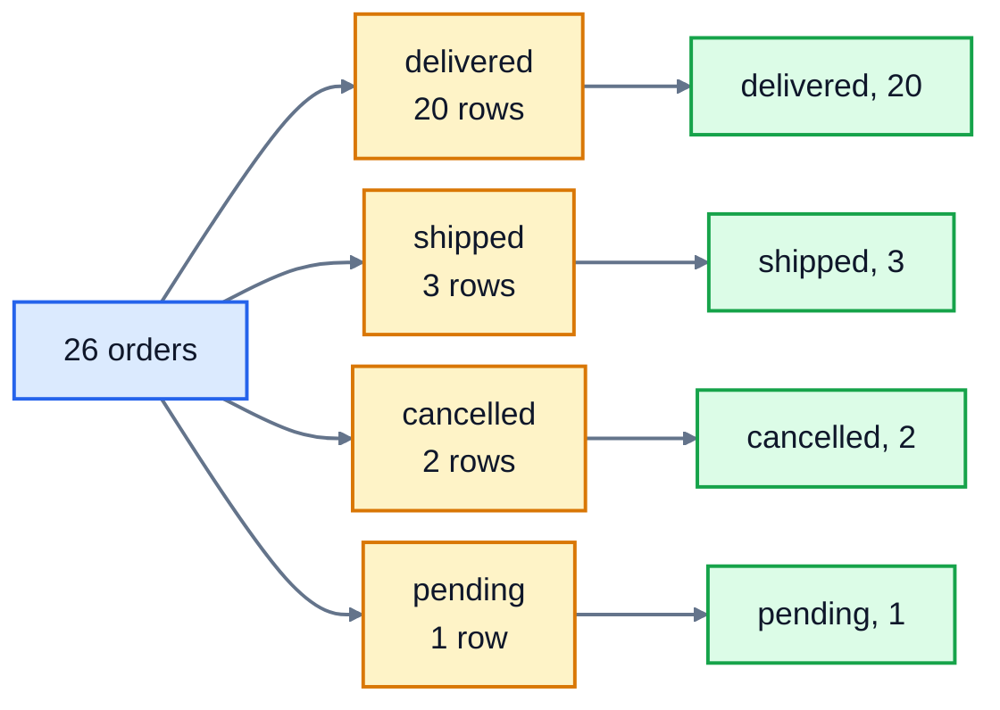

# 6. Aggregates and grouping

So far every query has returned rows from a table. Many real questions want a **summary** instead: How many orders did we get in June? What's our average book price? Which genre sells best? This lesson covers the functions that boil many rows down to one value, and `GROUP BY`, which does that for each group of rows separately.

## Aggregate functions

An **aggregate function** takes a whole column of values and returns one:

| Function | Returns |
|---|---|
| `COUNT(*)` | the number of rows |
| `COUNT(column)` | the number of rows where that column isn't NULL |
| `SUM(column)` | the total |
| `AVG(column)` | the average (the mean) |
| `MIN(column)`, `MAX(column)` | the smallest and largest value |

```sql
SELECT COUNT(*), MIN(price), MAX(price)
FROM books;
```

```
COUNT(*)  MIN(price)  MAX(price)
--------  ----------  ----------
20        5.99        14.99
```

The answer is a single row, however many rows the table has. You can combine aggregates with `WHERE` to summarise just some rows: `SELECT COUNT(*) FROM orders WHERE status = 'delivered';` gives 20.

### Aggregates skip NULL

Every aggregate except `COUNT(*)` ignores NULLs. There are 12 customers, but one has no city:

```sql
SELECT COUNT(*), COUNT(city), COUNT(DISTINCT city)
FROM customers;
```

```
COUNT(*)  COUNT(city)  COUNT(DISTINCT city)
--------  -----------  --------------------
12        11           5
```

`COUNT(DISTINCT city)` counts different values: Bristol, Glasgow, Leeds, London and Manchester. The same rule means `AVG` works out the average of the values that are there, not counting NULLs as zero.

## GROUP BY

`GROUP BY` splits the rows into groups that share a value, then runs the aggregates once per group. How many orders have each status?

```sql
SELECT status, COUNT(*)
FROM orders
GROUP BY status;
```

```
status     COUNT(*)
---------  --------
cancelled  2
delivered  20
pending    1
shipped    3
```



The orders are sorted into groups (amber), and each group becomes **one row** in the answer (green).

### The rule for SELECT with GROUP BY

Each result row stands for a whole group, so every column you `SELECT` must have one value per group. That means it's either:

- a column you grouped by (`status` above), or
- an aggregate (`COUNT(*)`, `SUM(quantity)` and so on).

`SELECT status, ordered_on, COUNT(*) FROM orders GROUP BY status` breaks the rule: the 20 delivered orders have 20 different dates, so which one should appear? Most databases refuse with an error. SQLite quietly picks one of them, which is worse, because the result looks fine but means nothing. Stick to the rule.

You can group by more than one column (`GROUP BY genre, author` makes a group for each genre and author pair) and by a calculation. Dates are stored as `'2025-06-15'`, so `substr(ordered_on, 1, 7)` gives the first 7 characters, `'2025-06'`, which groups the orders by month.

## HAVING: filtering groups

`WHERE` filters rows **before** they're grouped. To filter the groups themselves, by their counts or totals, use `HAVING`, which comes after `GROUP BY`. Which customers have placed at least 4 orders?

```sql
SELECT customer_id, COUNT(*) AS orders
FROM orders
GROUP BY customer_id
HAVING COUNT(*) >= 4
ORDER BY orders DESC;
```

```
customer_id  orders
-----------  ------
3            7
1            6
6            4
```

You can't write `WHERE COUNT(*) >= 4`: when `WHERE` runs, there are no groups yet, so there's nothing to count.

### The order a query runs in

It helps to know that the database doesn't run a query in the order it's written. It runs it in this order:

| Step | Clause | What it does |
|---|---|---|
| 1 | `FROM` | picks the table |
| 2 | `WHERE` | keeps matching rows |
| 3 | `GROUP BY` | sorts them into groups |
| 4 | `HAVING` | keeps matching groups |
| 5 | `SELECT` | works out the columns, including aggregates and aliases |
| 6 | `ORDER BY` | sorts the result |
| 7 | `LIMIT` | keeps the first few |

That explains a lot. `WHERE` can't use aggregates, because grouping hasn't happened yet. And `ORDER BY` can use an alias from `SELECT`, because `SELECT` has already run. (SQLite also lets `GROUP BY` and `HAVING` use aliases, though not every database does.)

## Exercise: summarise the shop

Open [exercise.sql](./exercise.sql) and answer the six questions:

1. How many books are there? Call the column `book_count`.
2. In one row: the total stock, the average price (rounded to 2 places), the lowest price and the highest price of all books.
3. For each genre: the genre, how many books it has, and their average price rounded to 2 places. Genres A to Z.
4. The 5 biggest orders: `order_id` and `total` (quantity times unit_price, added up, rounded to 2 places), biggest first.
5. Cities with more than one customer: the city and the number of customers, A to Z. Use `HAVING`.
6. The number of orders in each month: the month as `'YYYY-MM'` (call it `month`) and the count (call it `orders`), earliest month first.

```bash
cd 06-aggregates-and-grouping
python3 ../run.py exercise.sql
python3 -m unittest -v
```

<details>
<summary>Hints</summary>

- Q2: four aggregates separated by commas: `SUM(stock)`, `ROUND(AVG(price), 2)`, `MIN(price)`, `MAX(price)`.
- Q4: the order totals come from `order_items`. `SUM(quantity * unit_price)` multiplies each line first, then adds them up. Group by `order_id`.
- Q5: `GROUP BY city HAVING COUNT(*) > 1`.
- Q6: `substr(ordered_on, 1, 7) AS month`, then `GROUP BY month ORDER BY month`.

</details>

The answers are in [solutions/06-aggregates-and-grouping.sql](../solutions/06-aggregates-and-grouping.sql).

## Recap

- `COUNT`, `SUM`, `AVG`, `MIN` and `MAX` turn many rows into one value. All but `COUNT(*)` skip NULLs.
- `GROUP BY` runs the aggregates once per group. Each selected column must be grouped or aggregated.
- `WHERE` filters rows before grouping; `HAVING` filters groups after.
- A query runs `FROM`, `WHERE`, `GROUP BY`, `HAVING`, `SELECT`, `ORDER BY`, `LIMIT`.

Next: [7. Joins](../07-joins/)
