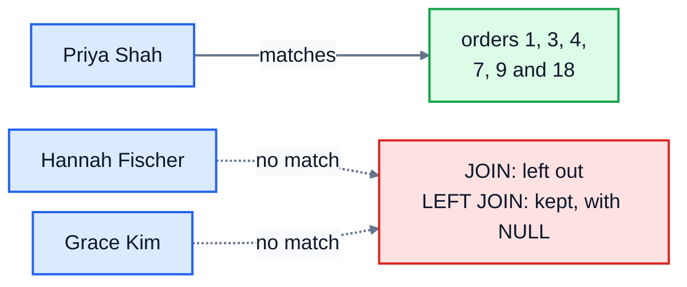

# 7. Joins

The bookshop keeps customers, orders, order items and books in separate tables, linked by ids. That's good design (lesson 1 explained why), but it means the answer to "who placed order 2?" is spread across two tables: `orders` says customer 6, and `customers` says customer 6 is Lucas Moreau. A **join** puts the pieces back together in one query.

## JOIN ... ON

```sql
SELECT orders.id, orders.ordered_on, customers.name
FROM orders
JOIN customers ON customers.id = orders.customer_id
WHERE orders.id <= 3;
```

```
id  ordered_on  name
--  ----------  ------------
1   2025-04-06  Priya Shah
2   2025-04-10  Lucas Moreau
3   2025-04-11  Priya Shah
```

`JOIN customers` brings in a second table, and `ON` says how rows match up: an order goes with the customer whose `id` equals the order's `customer_id`. For each order, the database finds the matching customer, and the result row has the columns of both.

The `ON` condition almost always links a foreign key to the primary key it points at, like `orders.customer_id` to `customers.id` here.

### Saying which table a column comes from

Both tables have a column called `id`, so the database can't tell which one you mean:

```sql
SELECT id, name FROM orders JOIN customers ON customers.id = orders.customer_id;
```

```
Error: ambiguous column name: id
```

Write `table.column`, like `orders.id`, whenever a name is in more than one table. It's a good habit to do it for every column in a join, so anyone reading the query knows where each one comes from.

### Shorter names with aliases

Typing `order_items.quantity` gets old quickly. Give each table a short **alias** with `AS`, and use that instead:

```sql
SELECT o.id, b.title, i.quantity
FROM orders AS o
JOIN order_items AS i ON i.order_id = o.id
JOIN books AS b ON b.id = i.book_id
WHERE o.id = 9;
```

```
id  title                    quantity
--  -----------------------  --------
9   Nineteen Eighty-Four     3
9   The Name of the Wind     1
9   Thinking, Fast and Slow  1
```

That query joins **three** tables. Just add another `JOIN ... ON` for each one. Here, each order item is matched to its order and to its book. Order 9 has three items, so it appears in three result rows: a join gives one row per **matching pair**, which is why an order with several books shows up several times.

## INNER JOIN and LEFT JOIN

Plain `JOIN` (also written `INNER JOIN`) only keeps rows that have a match on both sides. That's usually what you want, but not always. Hannah Fischer and Grace Kim have never ordered anything, so in a join of customers and orders, they simply vanish.

A **LEFT JOIN** keeps every row from the table on the **left** (the one after `FROM`) even when there's no match. The missing columns from the right-hand table are filled with NULL:

```sql
SELECT c.name, o.id
FROM customers AS c
LEFT JOIN orders AS o ON o.customer_id = c.id
WHERE c.id IN (1, 7, 11)
ORDER BY c.id, o.id;
```

```
name            id
--------------  ----
Priya Shah      1
Priya Shah      3
Priya Shah      4
Priya Shah      7
Priya Shah      9
Priya Shah      18
Hannah Fischer  NULL
Grace Kim       NULL
```



| Join | Keeps |
|---|---|
| `JOIN` (`INNER JOIN`) | only rows that match on both sides |
| `LEFT JOIN` | every row of the left table, with NULLs where there's no match |

(There's also `RIGHT JOIN`, the mirror image, and `FULL JOIN`, which keeps unmatched rows from both sides. SQLite has supported them since version 3.39, but you'll rarely need them: swap the tables around and use `LEFT JOIN`.)

### Finding rows with no match

The NULLs are useful. "Which customers have never ordered?" is a `LEFT JOIN` followed by "keep the rows where the right side is missing":

```sql
SELECT c.name
FROM customers AS c
LEFT JOIN orders AS o ON o.customer_id = c.id
WHERE o.id IS NULL;
```

### Counting with LEFT JOIN

To count each customer's orders, including zero, count a column from the right-hand table, not `*`:

```sql
SELECT c.name, COUNT(o.id)        -- Hannah Fischer 0, Grace Kim 0
SELECT c.name, COUNT(*)           -- Hannah Fischer 1, Grace Kim 1: wrong
```

`COUNT(*)` counts rows, and the `LEFT JOIN` gave Hannah one row (with NULLs). `COUNT(o.id)` skips NULLs, so she correctly gets 0.

## Joins and grouping together

Joins and `GROUP BY` go naturally together. "How many copies of each genre have we sold?" needs `order_items` (for quantities) and `books` (for genres):

```sql
SELECT b.genre, SUM(i.quantity) AS copies
FROM order_items AS i
JOIN books AS b ON b.id = i.book_id
GROUP BY b.genre
ORDER BY copies DESC;
```

The join happens first, giving one row per order item with its book's details attached. Then the rows are grouped by genre and added up.

### Forgetting the ON

If you join two tables without an `ON`, for example `SELECT * FROM customers, orders`, the database pairs **every** row with **every** row. With 12 customers and 26 orders, that's 312 rows of nonsense. If a join returns far more rows than you expected, check the `ON`.

## Exercise: joining tables

Open [exercise.sql](./exercise.sql) and answer the six questions:

1. Every order with the name of the customer who placed it: order id, customer name and ordered_on, by order id.
2. What's in order 3? The title, quantity and unit_price of each line, title A to Z.
3. Every customer and how many orders they've placed, including customers with none: name and order count. Most orders first, then name A to Z.
4. The title of every book that has never been ordered.
5. How much each customer has spent on delivered orders: name and total spent (rounded to 2 places). Biggest spender first.
6. Copies sold in each genre, counting every order except cancelled ones: genre and copies. Most copies first, then genre A to Z.

```bash
cd 07-joins
python3 ../run.py exercise.sql
python3 -m unittest -v
```

<details>
<summary>Hints</summary>

- Q2: join `order_items` to `books`, then `WHERE order_items.order_id = 3`.
- Q3: `LEFT JOIN`, `GROUP BY c.id`, and `COUNT(o.id)`, not `COUNT(*)`. Sorting needs both: `ORDER BY order_count DESC, c.name`.
- Q4: a `LEFT JOIN` from `books` to `order_items`, keeping rows where the order item side `IS NULL`.
- Q5: three tables: customers, orders and order_items. Filter with `WHERE o.status = 'delivered'` before grouping by customer.
- Q6: like the genre example above, plus a join to `orders` so you can leave out `o.status = 'cancelled'`.

</details>

The answers are in [solutions/07-joins.sql](../solutions/07-joins.sql).

## Recap

- `JOIN other ON other.id = this.other_id` combines rows from two tables that match.
- Write `table.column` (or `alias.column`) when a column name appears in more than one table.
- `JOIN` keeps only matched rows; `LEFT JOIN` keeps every row of the left table, with NULLs for missing matches.
- `LEFT JOIN ... WHERE right.id IS NULL` finds rows with no match. Count with `COUNT(right.id)`.
- A join without `ON` pairs every row with every row.

Next: [8. Subqueries and CASE](../08-subqueries-and-case/)
