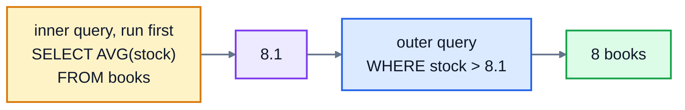

# 8. Subqueries and CASE

Some questions need two steps. "Which books cost more than average?" First you have to work out the average, then compare each book with it. This lesson covers three tools for questions like that: **subqueries** (a query inside a query), **CASE** (if-then-else for values), and **WITH** (naming a step so the query reads in order).

## Subqueries

A subquery is a `SELECT` in brackets, used inside another statement. The database runs it and uses the answer.

### A subquery that gives one value

The average stock is 8.1. Which books have more stock than that?

```sql
SELECT title, stock
FROM books
WHERE stock > (SELECT AVG(stock) FROM books)
ORDER BY stock DESC;
```

```
title                     stock
------------------------  -----
Pride and Prejudice       20
Nineteen Eighty-Four      17
The Midnight Library      15
The Hobbit                14
The Thursday Murder Club  12
Sapiens                   11
Frankenstein              10
Project Hail Mary         9
```

The database works from the inside out. It runs the inner query, puts its answer in place of the brackets, then runs the outer query:



The subquery `(SELECT AVG(stock) FROM books)` returns a single number, so it can go anywhere a number could. You couldn't write `WHERE stock > AVG(stock)`: as lesson 6 showed, aggregates can't be used in `WHERE`. A subquery is the way round it. And unlike typing `8.1` yourself, the query stays right when the stock changes.

### A subquery that gives a list

A subquery that returns one column can be used with `IN`. Which customers have never placed an order?

```sql
SELECT name
FROM customers
WHERE id NOT IN (SELECT customer_id FROM orders)
ORDER BY name;
```

```
name
--------------
Grace Kim
Hannah Fischer
Jack Wilson
Ravi Patel
```

That's the same answer as the `LEFT JOIN ... IS NULL` from lesson 7. Often there are several correct ways to write a query; pick the one that reads most clearly.

> Watch out with `NOT IN` when the list could contain a NULL: `x NOT IN (1, 2, NULL)` is never true, so the query returns nothing at all, because of the NULL rule from lesson 3. `customer_id` is `NOT NULL` here, so it's safe. `NOT EXISTS` (below) doesn't have this problem.

### A subquery for each row

A subquery can also refer to the row the outer query is looking at. This one counts how many times each Crime book appears in an order:

```sql
SELECT title,
       (SELECT COUNT(*) FROM order_items AS i WHERE i.book_id = b.id) AS times_ordered
FROM books AS b
WHERE b.genre = 'Crime';
```

```
title                            times_ordered
-------------------------------  -------------
The Girl with the Dragon Tattoo  3
Gone Girl                        2
The Thursday Murder Club         3
```

`b.id` inside the brackets means "the book in the current row", so the subquery runs once per book. This is called a **correlated subquery**. A join with `GROUP BY` can usually do the same job, often faster.

`EXISTS` asks whether a subquery returns any rows at all. It's a clear way to write "customers who have at least one order":

```sql
SELECT name FROM customers AS c
WHERE EXISTS (SELECT 1 FROM orders AS o WHERE o.customer_id = c.id);
```

## CASE: choosing a value

`CASE` picks a value depending on conditions, like `if` and `else` in a programming language. It's checked from the top, and the first `WHEN` that's true wins:

```sql
SELECT title, price,
       CASE
         WHEN price < 8 THEN 'budget'
         WHEN price >= 12 THEN 'premium'
         ELSE 'standard'
       END AS band
FROM books;
```

If no `WHEN` matches and there's no `ELSE`, the result is NULL. When every condition compares the same column with a value, there's a shorter form:

```sql
SELECT id, status,
       CASE status
         WHEN 'delivered' THEN 'done'
         WHEN 'cancelled' THEN 'done'
         ELSE 'open'
       END AS state
FROM orders
WHERE id BETWEEN 18 AND 23;
```

```
id  status     state
--  ---------  -----
18  delivered  done
19  cancelled  done
20  shipped    open
21  shipped    open
22  shipped    open
23  pending    open
```

A `CASE` can go anywhere a value can, including `GROUP BY` and `ORDER BY`. Grouping by a `CASE` is a neat way to count things in categories you make up, like price bands.

## WITH: one step at a time

When a query has a subquery inside a subquery inside a join, it gets hard to read. `WITH` lets you write the steps in order. Each step is a named query, called a **common table expression** (CTE), that the main query can use like a table.

Who are the top three customers by spending?

```sql
WITH spend AS (
  SELECT o.customer_id, SUM(i.quantity * i.unit_price) AS total
  FROM orders AS o
  JOIN order_items AS i ON i.order_id = o.id
  GROUP BY o.customer_id
)
SELECT c.name, ROUND(spend.total, 2) AS total
FROM spend
JOIN customers AS c ON c.id = spend.customer_id
ORDER BY total DESC
LIMIT 3;
```

```
name          total
------------  ------
Aisha Bello   261.56
Lucas Moreau  146.36
Priya Shah    142.36
```

Step one, `spend`, works out each customer's total. Step two joins that to the customer names. You can define several steps, separated by commas: `WITH a AS (...), b AS (...) SELECT ...`, and later steps can use earlier ones. (Notice these totals include every order, even cancelled ones. The exercise asks you to be more careful.)

## Exercise: two-step questions

Open [exercise.sql](./exercise.sql) and answer the six questions:

1. The title and price of books that cost more than the average book, most expensive first, then title A to Z.
2. The name of every customer who has placed at least one order, A to Z. Use `IN` with a subquery.
3. Each book's title, price and price band (call it `band`): `'budget'` under 8, `'premium'` 12 or more, and `'standard'` for everything else. Cheapest first, then title A to Z.
4. How many books are `'out of stock'` (0), `'low'` (1 to 4) and `'fine'` (5 or more)? The label (call it `level`) and the count, label A to Z.
5. The average value of a delivered order, rounded to 2 places. Work out each order's total in a `WITH` query first.
6. The name of the customer who placed the most recent order, and its date.

```bash
cd 08-subqueries-and-case
python3 ../run.py exercise.sql
python3 -m unittest -v
```

<details>
<summary>Hints</summary>

- Q1: `WHERE price > (SELECT AVG(price) FROM books)`.
- Q2: `WHERE id IN (SELECT customer_id FROM orders)`. `IN` doesn't mind that some ids appear in the list many times.
- Q4: put the `CASE` in the `SELECT` with `AS level`, then `GROUP BY level`. The order of the `WHEN`s matters: check `stock = 0` before `stock < 5`.
- Q5: in the `WITH` step, join `order_items` to `orders`, keep `status = 'delivered'`, and group by order. Then `SELECT ROUND(AVG(total), 2) FROM` that step.
- Q6: join orders to customers, and keep the order whose date equals `(SELECT MAX(ordered_on) FROM orders)`.

</details>

The answers are in [solutions/08-subqueries-and-case.sql](../solutions/08-subqueries-and-case.sql).

## Recap

- A **subquery** is a `SELECT` in brackets. One value: use it like a number. One column: use it with `IN`.
- A **correlated** subquery refers to the outer row and runs once per row. `EXISTS` checks whether it returns anything.
- `CASE WHEN ... THEN ... ELSE ... END` chooses a value. The first true `WHEN` wins.
- `WITH name AS (...)` names a step, so complicated queries read from top to bottom.

Next: [9. Database design](../09-database-design/)
