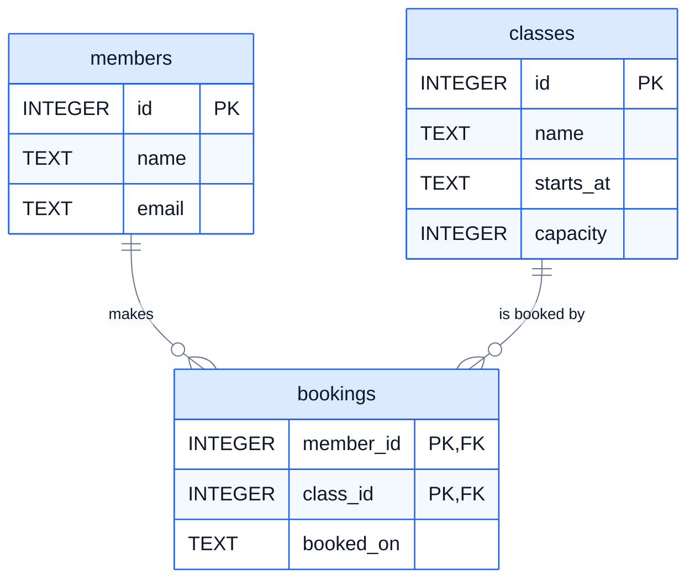

# 9. Database design

So far you've used a database someone else designed. This lesson is about designing one yourself: deciding which tables to have, what goes in each, and how they link. Good design makes every query in lessons 2 to 8 easy. Bad design makes the data contradict itself.

The example is a local gym that runs classes (spin, yoga, circuits) and wants to take bookings online.

## Starting from a spreadsheet

Here's how the gym tracks bookings today, in one big sheet:

| member | email | class | starts | capacity | booked |
|---|---|---|---|---|---|
| Nadia Hussain | nadia@example.com | Spin | 2025-09-01 07:00 | 12 | 2025-08-28 |
| Ben Carter | ben@example.com | Spin | 2025-09-01 07:00 | 12 | 2025-08-29 |
| Nadia Hussain | nadia@example.com | Yoga | 2025-09-01 18:30 | 20 | 2025-08-30 |
| Nadia Hussain | nadia@exmaple.com | Spin | 2025-09-03 07:00 | 12 | 2025-08-31 |

It works for a while. Then the problems start:

- **The same fact is stored many times.** Nadia's email is in three rows, and one of them has a typo. Which is right? If she changes her email, every row has to be found and fixed.
- **You can't store something until something else happens.** A new class with no bookings yet has nowhere to go. A member who's joined but not booked anything doesn't exist.
- **Deleting one thing deletes another.** If Ben cancels his only booking and you delete the row, you've lost the fact that Ben is a member at all.

All three come from one cause: the sheet mixes facts about **three different things** in every row: a member, a class, and a booking that connects them.

## One table per thing

The fix is to give each kind of thing its own table, and store each fact once:

- **members**: one row per member, with their name and email.
- **classes**: one row per class session, with its name, start time and capacity.
- **bookings**: one row per booking, saying which member booked which class, and when.



How to read the lines: `||` means "exactly one" and `o{` means "zero or more". So one member makes zero or more bookings, and each booking belongs to exactly one member.

Now Nadia's email is stored once. A new class can exist before anyone books it. Cancelling Ben's booking deletes one row from `bookings`, and Ben is still in `members`. The four rows of the spreadsheet become two members, three classes and four bookings.

## Relationships

Tables relate to each other in three ways:

| Relationship | Example | How it's stored |
|---|---|---|
| **One-to-many** | one customer has many orders | a foreign key on the "many" side: `orders.customer_id` |
| **Many-to-many** | a member books many classes; a class has many members | a **junction table** in between: `bookings`, with a foreign key to each side |
| **One-to-one** | a member has one locker | a foreign key with `UNIQUE`, or just extra columns on the same table |

Many-to-many is the one that needs thought. You can't put a `class_id` column on members (a member books many classes), or a `member_id` on classes (a class has many members). The relationship itself becomes a table. The bookshop does the same thing: `order_items` is the junction between orders and books, and it holds facts about the relationship itself, the quantity and the price paid.

### A primary key made of two columns

A member shouldn't be able to book the same class twice. In `bookings`, the pair (`member_id`, `class_id`) must be unique, so that pair can be the primary key:

```sql
PRIMARY KEY (member_id, class_id)
```

This is a **composite key**. It goes on its own line at the end of `CREATE TABLE`, because it's about two columns, not one.

## Rules of thumb for good design

Database people call this process **normalisation**, and there are formal rules for it (first, second and third "normal form"). In plain words, they say:

- **One value per cell.** Not "Spin, Yoga" in one cell. If there can be several, they belong in another table, one per row.
- **Store each fact once.** If the same information appears in many rows, it probably belongs in its own table, linked by an id.
- **Every column should be about the row's thing, the whole thing, and nothing but the thing.** A class's capacity is about the class, so it goes in `classes`, not in `bookings`.

A few more habits that save trouble later:

- **Give every table a simple `id INTEGER PRIMARY KEY`**, rather than using something meaningful like an email as the key. Emails change; ids don't.
- **Store values that can be calculated only if you have a reason.** The number of people booked on a class can be counted from `bookings` (lesson 6), so don't keep a separate "booked" column that could drift out of date. The bookshop does store `unit_price` in `order_items`, even though books have a price, because the price a customer paid must not change when the shop changes its prices later. That's a good reason.
- **Use constraints** (lesson 4) for every rule you can: `NOT NULL`, `UNIQUE`, `CHECK`, `REFERENCES`.
- **Consistent names**: plural lowercase table names, `snake_case` columns, and foreign keys named after the table they point to, like `member_id`.
- **Money**: SQLite's `REAL` can't store most decimals exactly (lesson 2). That's fine for a course, but real payment systems usually store whole numbers of pence or cents in an `INTEGER` column, so 10.99 is stored as 1099.

Not every rule can be a constraint. "A class can't have more bookings than its capacity" depends on counting other rows, which a `CHECK` can't do. Rules like that go in the application code, or in a database **trigger**, which is beyond this course.

## Exercise: design the gym's database

Open [exercise.sql](./exercise.sql). This lesson starts with an **empty** database, so run it with `--empty`:

```bash
cd 09-database-design
python3 ../run.py --empty exercise.sql
python3 -m unittest -v
```

**Q1.** Create the `members` table: `id` (the primary key), `name` (required) and `email` (required, and no two members can share one).

**Q2.** Create the `classes` table: `id` (the primary key), `name` (required), `starts_at` (required, text like `'2025-09-01 07:00'`) and `capacity` (required, a whole number above 0).

**Q3.** Create the `bookings` table: `member_id` (required, must be a member's id), `class_id` (required, must be a class's id) and `booked_on` (required, a date). A member can book a class only once, so make (`member_id`, `class_id`) the primary key.

**Q4.** Add this example data, then list each class's name and how many people have booked it, class name A to Z:

```sql
INSERT INTO members (id, name, email) VALUES (1, 'Nadia Hussain', 'nadia@example.com'), (2, 'Ben Carter', 'ben@example.com');
INSERT INTO classes (id, name, starts_at, capacity) VALUES (1, 'Spin', '2025-09-01 07:00', 12), (2, 'Yoga', '2025-09-01 18:30', 20);
INSERT INTO bookings (member_id, class_id, booked_on) VALUES (1, 1, '2025-08-28'), (2, 1, '2025-08-29'), (1, 2, '2025-08-30');
```

The tests try to break your design: two members with the same email, a class with a capacity of 0, a booking for a member who doesn't exist, the same member booking a class twice, and more. Your tables must refuse every one, and still accept the good data above.

<details>
<summary>Hints</summary>

- Q1 is like `customers`: `email TEXT NOT NULL UNIQUE`.
- Q2: `capacity INTEGER NOT NULL CHECK (capacity > 0)`.
- Q3: `member_id INTEGER NOT NULL REFERENCES members(id)`, the same for `class_id`, then after the last column, a comma and `PRIMARY KEY (member_id, class_id)`. Don't give `bookings` its own `id` column.
- Q4: paste the three `INSERT`s, then a `LEFT JOIN` from `classes` to `bookings` with `COUNT(b.member_id)` and `GROUP BY c.id`, as in lesson 7.

</details>

The answers are in [solutions/09-database-design.sql](../solutions/09-database-design.sql).

## Recap

- One table per kind of thing. Store each fact once, and link tables by id.
- One-to-many: a foreign key on the "many" side. Many-to-many: a junction table with a foreign key to each side.
- A composite primary key, `PRIMARY KEY (a, b)`, makes a pair of columns unique.
- Use constraints for every rule you can, and simple integer ids as primary keys.

Next: [10. Indexes and transactions](../10-indexes-and-transactions/)
