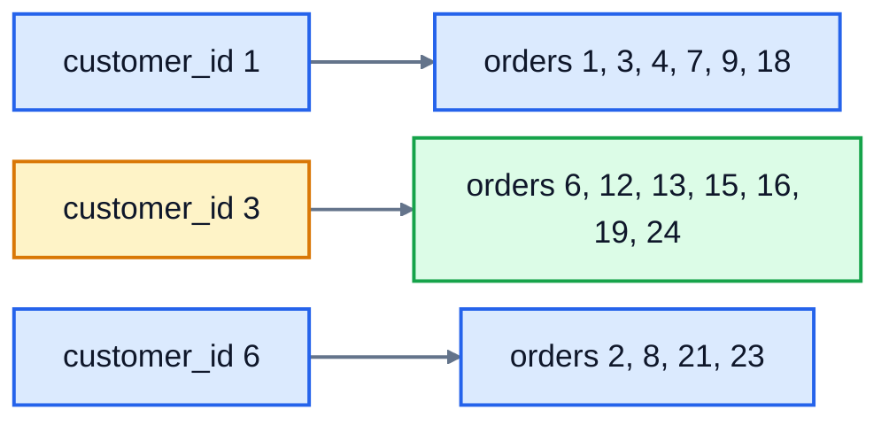
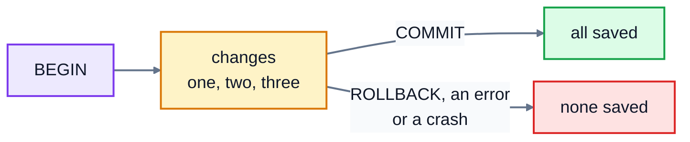

# 10. Indexes and transactions

Two things separate a toy database from one a business can run on. **Indexes** keep queries fast when tables have millions of rows. **Transactions** make sure a group of changes happens completely or not at all, even if something goes wrong halfway through.

## Indexes

### The problem: reading every row

How does the database answer this?

```sql
SELECT * FROM orders WHERE customer_id = 3;
```

Without help, it has to look at **every row** of `orders` and check its `customer_id`. That's called a **full table scan**. With 26 orders you'd never notice. On one laptop, with a million orders in the table, this query took **114 milliseconds**. Do that for every page a customer opens and the site crawls.

You can ask the database how it plans to run a query, by putting `EXPLAIN QUERY PLAN` in front:

```sql
EXPLAIN QUERY PLAN SELECT * FROM orders WHERE customer_id = 3;
```

```
id  parent  notused  detail
--  ------  -------  -----------
2   0       0        SCAN orders
```

`SCAN orders` means it reads the whole table.

### The fix: an index

An index works like the index at the back of a book. Instead of reading every page to find "foreign keys", you look it up in the alphabetical index, which tells you the page numbers. A database index is a separate, sorted structure (usually a **B-tree**, a relative of lesson 8's tree in the Data Structures course) that maps each `customer_id` to the rows that have it. Here's part of it. Looking up customer 3 (amber) leads straight to their seven orders (green):



```sql
CREATE INDEX idx_orders_customer ON orders (customer_id);
```

Now the plan changes:

```
id  parent  notused  detail
--  ------  -------  -------------------------------------------------------------
3   0       0        SEARCH orders USING INDEX idx_orders_customer (customer_id=?)
```

`SEARCH ... USING INDEX` means it jumps straight to the matching rows. On the million-row table, the same query went from 114 milliseconds to **0.28 milliseconds**, about 400 times faster. You don't change your queries at all: the database decides to use the index by itself.

### What to index

- **Primary keys are already indexed.** `WHERE id = 42` is fast with no extra work.
- **Foreign keys usually deserve an index**, like `orders.customer_id`, because joins and "this customer's orders" look them up constantly. Some databases create these automatically; SQLite doesn't.
- **Columns you often search, filter or sort by**, like `books.author` or `orders.ordered_on`.
- `UNIQUE` constraints create an index automatically, which is how the database checks for duplicates quickly.

An index on two columns, `CREATE INDEX idx ON books (genre, price)`, helps queries that filter on `genre`, or on `genre` and `price` together, but not on `price` alone, just as a phone book sorted by surname then first name doesn't help you find everyone called "Sam".

### The cost

Indexes aren't free. Each one takes disk space, and every `INSERT`, `UPDATE` and `DELETE` has to update every index on the table too. Building the index on a million orders took about 2 seconds. So don't index every column: index the ones your queries actually search, and check with `EXPLAIN QUERY PLAN`.

## Transactions

### The problem: half a change

When a customer orders two copies of The Hobbit, three things must happen:

1. Add a row to `orders`.
2. Add a row to `order_items`.
3. Take 2 off The Hobbit's stock.

What if the server crashes after step 2? There's an order the warehouse will try to send, but the stock says the books are still on the shelf. The data now contradicts itself, and nobody knows.

### The fix: all or nothing

A **transaction** groups statements so they succeed or fail **as one**:

```sql
BEGIN;

INSERT INTO orders (id, customer_id, ordered_on, status)
VALUES (27, 4, '2025-07-12', 'pending');

INSERT INTO order_items (order_id, book_id, quantity, unit_price)
VALUES (27, 1, 2, 9.99);

UPDATE books SET stock = stock - 2 WHERE id = 1;

COMMIT;
```

- `BEGIN` starts the transaction.
- `COMMIT` saves all of the changes, permanently, at once.
- `ROLLBACK` throws all of them away, as if they never happened.
- If the program or the computer crashes before `COMMIT`, the database rolls back by itself the next time it opens.



### ROLLBACK as an undo button

A transaction also lets you take back a mistake before it's saved:

```sql
BEGIN;
DELETE FROM order_items;            -- OK, 45 rows changed
SELECT COUNT(*) FROM order_items;   -- 0
ROLLBACK;
SELECT COUNT(*) FROM order_items;   -- 45: they're all back
```

Remember the missing `WHERE` from lesson 5? Running risky changes inside a transaction, checking the result, and only then committing is a good habit on a real database.

### When something fails part-way

Constraints and transactions work together. Suppose the order was for 30 copies of The Hobbit, but only 14 are in stock:

```sql
BEGIN;
UPDATE books SET stock = stock - 30 WHERE id = 1;
```

```
Error: CHECK constraint failed: stock >= 0
```

The `CHECK` refuses the update. The program sees the error and runs `ROLLBACK`, so the order rows inserted earlier in the transaction disappear too. No half order is left behind. (In SQLite, a failed statement undoes only itself; it's the `ROLLBACK` that undoes the rest. Programs usually send `ROLLBACK` automatically when something goes wrong, as lesson 11 shows.)

### ACID

The guarantees a transaction gives are often summed up as **ACID**:

| Letter | Stands for | Means |
|---|---|---|
| A | Atomic | all of the changes happen, or none do |
| C | Consistent | the constraints hold before and after |
| I | Isolated | other users don't see your changes until you commit |
| D | Durable | once committed, the changes survive a crash or power cut |

Every serious relational database, SQLite included, gives these guarantees. It's one of the main reasons to use a database instead of a pile of files.

Even without `BEGIN`, every single statement runs in its own little transaction: an `UPDATE` that changes 20 rows changes all 20 or none of them.

## Exercise: speed and safety

Open [exercise.sql](./exercise.sql). The answers run in order.

1. Create an index called `idx_orders_customer` on the `customer_id` column of `orders`.
2. Create an index called `idx_books_author` so that searching books by `author` can use it.
3. Record a new order **in one transaction**: order 27 for customer 4 on `'2025-07-12'` with status `'pending'`, containing 2 copies of The Hobbit (book 1) at 9.99, and take those 2 copies off The Hobbit's stock.
4. Start a transaction, delete every row in `order_items`, then change your mind and undo it, so nothing is lost.

```bash
cd 10-indexes-and-transactions
python3 ../run.py exercise.sql
python3 -m unittest -v
```

The test for Q2 runs `EXPLAIN QUERY PLAN` on a search by author and checks that it uses your index. Try that yourself, before and after creating it.

<details>
<summary>Hints</summary>

- Q1 and Q2: `CREATE INDEX name ON table (column);`.
- Q3: `BEGIN;`, the two `INSERT`s and the `UPDATE` from the example above, then `COMMIT;`.
- Q4: `BEGIN;`, then `DELETE FROM order_items;`, then `ROLLBACK;`.

</details>

The answers are in [solutions/10-indexes-and-transactions.sql](../solutions/10-indexes-and-transactions.sql).

## Recap

- Without an index, a search reads every row. `EXPLAIN QUERY PLAN` shows `SCAN` (every row) or `SEARCH ... USING INDEX`.
- `CREATE INDEX name ON table (column)` makes searches on that column fast, at the cost of space and slower writes. Index foreign keys and columns you search often.
- `BEGIN` ... `COMMIT` makes a group of changes all-or-nothing. `ROLLBACK` cancels them.
- ACID: atomic, consistent, isolated, durable.

Next: [11. SQL from Python](../11-sql-from-python/)
