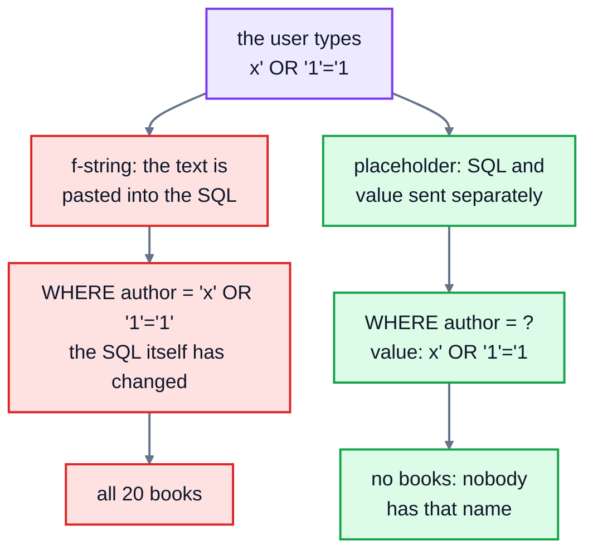

# 11. SQL from Python

In real life, people rarely type SQL by hand to run a shop. A program does it: the website's code runs a query when you search, and an `INSERT` when you order. This lesson shows how a Python program talks to a database, and the one security rule you must never break.

Python's built-in **`sqlite3`** module is all you need. Other databases have very similar Python modules (`psycopg` for PostgreSQL, for example), so what you learn here carries over.

## Connecting and querying

To follow along, save a copy of the bookshop database to a file, from the course's top folder:

```bash
python3 run.py --save bookshop.db
```

Then, in Python:

```python
import sqlite3

connection = sqlite3.connect("bookshop.db")
connection.execute("PRAGMA foreign_keys = ON")

rows = connection.execute("SELECT title, price FROM books WHERE genre = 'Crime'").fetchall()
print(rows)

connection.close()
```

```
[('The Girl with the Dragon Tattoo', 8.99), ('Gone Girl', 8.49), ('The Thursday Murder Club', 9.99)]
```

- `sqlite3.connect(path)` opens the database file, creating it if it doesn't exist. It returns a **connection**.
- `connection.execute(sql)` runs one statement and returns a **cursor**, which holds the results.
- `.fetchall()` gives every result row as a list of **tuples**, one value per column. `.fetchone()` gives just the next row, or `None` if there are no more. You can also loop over the cursor directly: `for title, price in connection.execute(...):`.
- Remember `PRAGMA foreign_keys = ON` (lesson 4) every time you connect, or SQLite won't check foreign keys.

A row is a tuple, so `row[0]` is the first column. If you'd rather use names, set `connection.row_factory = sqlite3.Row`, and then `row["title"]` works too.

## Passing values in: placeholders

Programs rarely run fixed queries. They search for whatever the user typed. You might be tempted to build the SQL with an f-string:

```python
author = input("Author: ")
query = f"SELECT title FROM books WHERE author = '{author}'"    # never do this
```

Here's what happens when someone types `x' OR '1'='1` as the author:

```
SELECT title FROM books WHERE author = 'x' OR '1'='1'
```

Their quote mark closed your text early, and the rest of what they typed became **part of your SQL**. `'1'='1'` is always true, so the query returns all 20 books. That's **SQL injection**. On a real site, the same trick has been used to log in without a password, read other people's data, and delete tables. It's been one of the most common security holes on the web for over twenty years.

The fix is simple, and it's the only safe way: put a **`?` placeholder** in the SQL where each value goes, and pass the values separately, as a tuple:

```python
rows = connection.execute(
    "SELECT title FROM books WHERE author = ?",
    (author,),
).fetchall()
```

Now the database receives the SQL and the value separately. It treats the value purely as data, whatever characters it contains. The sneaky input just looks for an author literally called `x' OR '1'='1`, and finds nobody: `[]`.

Here are the two ways side by side:



A few details:

- Pass a **tuple**, even for one value. `(author,)` needs that trailing comma. If you pass a plain string, Python treats each character as a separate value: `Incorrect number of bindings supplied. The current statement uses 1, and there are 9 supplied.`
- Use one `?` per value: `"INSERT INTO customers (name, email) VALUES (?, ?)", (name, email)`.
- Placeholders are for **values** only, not table or column names.
- For `LIKE`, add the `%` signs in the SQL, with `||` (SQL's way of joining text): `"WHERE title LIKE '%' || ? || '%'"`.
- Python's `None` becomes SQL's NULL.

This doesn't only protect against attackers. It also means names like "Siobhán O'Neill" just work, with no worrying about doubling the apostrophe.

## Changing data: commit

Changes like `INSERT`, `UPDATE` and `DELETE` happen inside a transaction (lesson 10) that Python's `sqlite3` module starts for you. **Nothing is saved until you call `connection.commit()`.** If your program ends without it, the changes are lost.

```python
cursor = connection.execute(
    "INSERT INTO customers (name, email, city, joined_on) VALUES (?, ?, ?, ?)",
    ("Ella Brooks", "ella.brooks@example.com", "York", "2025-07-12"),
)
connection.commit()
print(cursor.lastrowid)    # the id the database chose: 13
```

Two cursor attributes are useful after a change:

- `cursor.lastrowid`: the id of the row just inserted.
- `cursor.rowcount`: how many rows an `UPDATE` or `DELETE` changed. If it's 0, the `WHERE` matched nothing, which often means the id was wrong.

To insert many rows at once, `connection.executemany(sql, list_of_tuples)` runs the same statement for each tuple.

### Transactions the easy way

Using the connection in a `with` block makes it a transaction: if everything inside works, it commits; if an exception happens, it rolls back.

```python
with connection:
    connection.execute("INSERT INTO orders (customer_id, ordered_on, status) VALUES (?, ?, ?)", (4, "2025-07-12", "pending"))
    connection.execute("UPDATE books SET stock = stock - ? WHERE id = ?", (2, 1))
```

If the `UPDATE` fails (say, the stock would go negative), the `INSERT` is undone too, and the exception carries on so your program can deal with it. (The `with` block doesn't close the connection; call `connection.close()` when you've finished.)

### Errors

When the database refuses something, Python raises an exception. Constraint failures are `sqlite3.IntegrityError`, for example `UNIQUE constraint failed: customers.email`. Mistakes in the SQL itself are `sqlite3.OperationalError`, like `no such column: titel`. All of them are kinds of `sqlite3.Error`, so you can catch them like any other exception.

## Exercise: the bookshop's Python code

Open [exercise.py](./exercise.py). Each function receives a `connection` to a fresh copy of the bookshop database. Write:

| Function | What it does |
|---|---|
| `books_by_author(connection, author)` | returns a list of the **titles** (plain strings) by that author, A to Z |
| `find_books(connection, text)` | returns `(title, price)` tuples for books whose title contains `text`, in any case, title A to Z |
| `order_total(connection, order_id)` | returns the order's total, rounded to 2 places, or `None` if there's no such order |
| `add_customer(connection, name, email, city, joined_on)` | inserts the customer, commits, and returns the new id |
| `restock(connection, book_id, amount)` | adds `amount` to the book's stock and commits. Raises `ValueError` if there's no book with that id. |

Every value must go through a `?` placeholder. The tests check that each `execute()` gets a plain string, not one built with an f-string, `+` or `.format()`, and they try the `x' OR '1'='1` trick on your search functions.

Run the tests from the lesson folder:

```bash
cd 11-sql-from-python
python3 -m unittest -v
```

Running `python3 exercise.py` tries each function. When everything works, it prints:

```
['Project Hail Mary', 'The Martian']
[('The Midnight Library', 9.49)]
71.44
13
('Atomic Habits', 12)
[]
```

<details>
<summary>Hints</summary>

- `books_by_author`: `connection.execute("SELECT title FROM books WHERE author = ? ORDER BY title", (author,)).fetchall()` gives `[('Project Hail Mary',), ...]`. Loop over that and collect `row[0]`.
- `order_total`: `SELECT ROUND(SUM(quantity * unit_price), 2) FROM order_items WHERE order_id = ?`. With no matching rows, `SUM` gives NULL, which arrives as `None`, so `.fetchone()[0]` is already the right answer.
- `add_customer`: keep the cursor that `execute` returns, call `connection.commit()`, then return `cursor.lastrowid`.
- `restock`: after the `UPDATE`, check `cursor.rowcount`. If it's 0, `raise ValueError(f"No book with id {book_id}")`. (An f-string in an error message is fine. It's only SQL you must never build that way.)

</details>

The full answer is in [solutions/11-sql-from-python.py](../solutions/11-sql-from-python.py).

## Recap

- `sqlite3.connect(path)`, then `connection.execute(sql, values)`. Read results with `.fetchall()` or `.fetchone()`.
- **Always** pass values with `?` placeholders. Building SQL from user input with f-strings causes SQL injection.
- Changes aren't saved until `connection.commit()`. `with connection:` commits on success and rolls back on error.
- `cursor.lastrowid` is the new row's id; `cursor.rowcount` is how many rows changed.

## What's next

That's the whole course. You can now query a database, change it safely, design one, and use it from a program. Good next steps:

- Install **PostgreSQL**, the most popular open-source database for web applications, and try these lessons' queries there. Almost all of them work unchanged.
- Learn **window functions** (`ROW_NUMBER()`, `RANK()`, running totals with `SUM(...) OVER (...)`), the next big step up in SQL. SQLite supports them.
- Try an **ORM** such as SQLAlchemy or the Django ORM, which writes SQL for you from Python classes. Knowing the SQL underneath will make you much better at using one.
