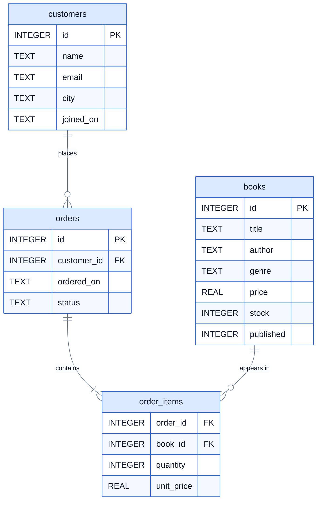

# Databases and SQL

Almost every app you use keeps its data in a database: your bank balance, your online orders, the messages in a chat. **SQL** is the language for asking a database questions and changing what's in it. It's been around since the 1970s, it's used by nearly every company, and the basics take a few days to learn.

This course uses one example all the way through: the database of a small online bookshop. You'll query it, change it, design new tables for it, and finally use it from Python.

## Who this is for

Complete beginners to databases. You don't need to know any programming for lessons 1 to 10. Lesson 11 uses Python; if you need a refresher, see [Python Basics](https://github.com/The-Future-Root/python-basics).

## What you need

- **Python 3.10 or newer**, from [python.org](https://www.python.org/downloads/). Check with `python3 --version` (on Windows, `python --version`). Python comes with SQLite built in, so there's nothing else to install.
- **A text editor**, such as VS Code.
- Optional: the **`sqlite3`** command-line program, from [sqlite.org](https://sqlite.org/download.html), or a visual tool like [DB Browser for SQLite](https://sqlitebrowser.org/). They're nice for exploring, but you don't need them.

## The bookshop database

[data/bookshop.sql](./data/bookshop.sql) builds the database: four tables of customers, books, orders and the books in each order. Lesson 1 takes a tour of it.



## Lessons

| # | Lesson | You'll learn |
|---|---|---|
| 1 | [What is a database?](./01-what-is-a-database/) | Tables, rows, columns and keys, and your first query |
| 2 | [Selecting data](./02-selecting-data/) | Choosing columns, calculating, sorting and limiting |
| 3 | [Filtering rows](./03-filtering-rows/) | `WHERE`, `AND`, `OR`, `IN`, `BETWEEN`, `LIKE` and `NULL` |
| 4 | [Creating tables](./04-creating-tables/) | `CREATE TABLE`, data types, constraints and `INSERT` |
| 5 | [Changing data](./05-changing-data/) | `UPDATE`, `DELETE` and `ALTER TABLE`, safely |
| 6 | [Aggregates and grouping](./06-aggregates-and-grouping/) | `COUNT`, `SUM`, `AVG`, `GROUP BY` and `HAVING` |
| 7 | [Joins](./07-joins/) | Combining tables with `JOIN` and `LEFT JOIN` |
| 8 | [Subqueries and CASE](./08-subqueries-and-case/) | Queries inside queries, `CASE` and `WITH` |
| 9 | [Database design](./09-database-design/) | Keys, relationships and normalisation, for a gym's booking system |
| 10 | [Indexes and transactions](./10-indexes-and-transactions/) | Making queries fast, and making changes all-or-nothing |
| 11 | [SQL from Python](./11-sql-from-python/) | The `sqlite3` module, placeholders and SQL injection |

## How the exercises work

Each lesson folder has an `exercise.sql` file with numbered questions. Write your SQL under each one:

```sql
-- Q1: The title and price of every Crime book.
SELECT title, price
FROM books
WHERE genre = 'Crime';
```

To see what your queries return, run the file from the lesson's folder:

```bash
cd 03-filtering-rows
python3 ../run.py exercise.sql
```

`run.py` builds a fresh copy of the bookshop database every time, so you can't break anything: if you delete every book by mistake, just run it again. You can also try a single query with `python3 ../run.py -c "SELECT * FROM books;"`.

When you think you have the answers, check them with the tests:

```bash
python3 -m unittest -v
```

Each test runs one of your answers and compares what it returns with the right result. A failing test tells you which question is wrong and how. Lesson 11 is a Python exercise, with `exercise.py` instead.

On Windows, type `python` instead of `python3`.

Hints are at the end of each lesson, and full answers are in [solutions/](./solutions/).

## About the diagrams

The colours keep the same meaning throughout: **blue** for tables and data, **green** for rows that are kept or the result you get, **amber** for the step happening now, **red** for rows that are removed or refused, and **purple** for labels.

## License

The code in this repository is released under the [MIT License](./LICENSE). The lesson text and diagrams are released under [Creative Commons Attribution 4.0](./LICENSE-CONTENT) (CC BY 4.0): you may share and adapt them, including for your own teaching, as long as you credit The Future Root.
